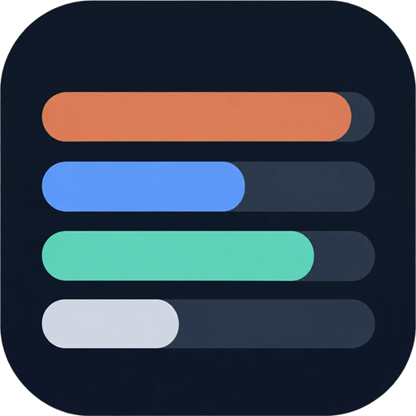
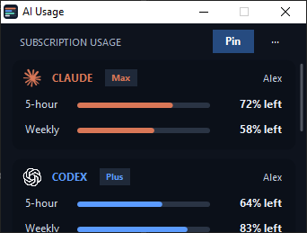
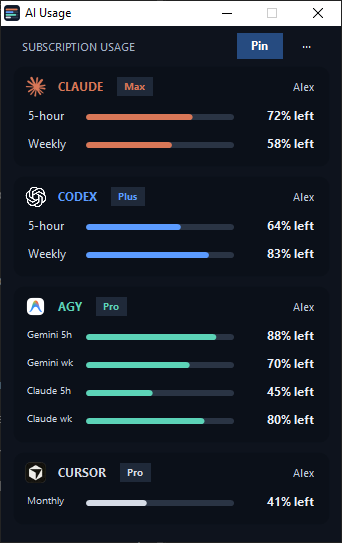
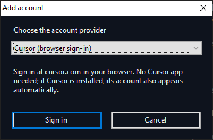

<p align="center"></p>

# AI Usage Widget

A tiny always-on-top Windows window that shows how much of your **Claude Code**, **Codex**, **Antigravity** and **Cursor** subscription limits you have left. It is portable, needs no installer, and has no cloud backend.

<p align="center">
  
  &nbsp;
  
</p>
<p align="center"><sub>Left: the compact window (it scrolls). Right: the full list of providers. Sample data.</sub></p>

> Unofficial community tool. Not affiliated with or endorsed by Anthropic, OpenAI, Google or Anysphere (Cursor). Several of the usage endpoints it reads are internal and may change without notice.

## Download

1. Download `AIUsageWidget-<version>-win-x64.zip` from [Releases](../../releases).
2. Check the hash against the one in the release notes:
   ```powershell
   Get-FileHash .\AIUsageWidget-*-win-x64.zip -Algorithm SHA256
   ```
3. Unzip anywhere and run `AIUsageWidget.exe`. Keep `AIUsageWidget.exe.config` and the `assets` folder next to it.

Needs Windows 10 or 11, which includes .NET Framework 4.8. Nothing else to install.

### Antivirus warnings

The release exe is **not code-signed**, and it does things that heuristic scanners associate with credential stealers. It reads other apps' local sign-in files (Claude Code, Codex and Cursor), asks WMI for Antigravity's process command line, and sends those tokens to the providers' usage endpoints. A few machine-learning engines on VirusTotal flag it as a generic `trojan.msil` because of this. That's why the full source is here: read it, then [build it yourself](#build-from-source) and run your own build. Windows' built-in compiler doesn't produce byte-identical builds, so your exe's hash will differ from the release. The release hash only proves your download wasn't altered.

## What it shows

Claude is orange, Codex blue, Antigravity teal and Cursor silver. Bars and numbers show the allowance **left**. Readings refresh every 60 seconds. Limits a provider doesn't report are hidden. Hover over a bar to see its reset time, or why a reading is stale.

| Provider | Source | Bars |
|---|---|---|
| Claude Code | `~/.claude/.credentials.json` (or `CLAUDE_CONFIG_DIR`), Claude usage endpoint | 5-hour, Weekly |
| Codex | `~/.codex/auth.json` (or `CODEX_HOME`), the Codex `app-server` rate-limits method | 5-hour, Weekly |
| Antigravity | local language-server service of the running Antigravity app | Gemini 5h/wk, Claude/GPT 5h/wk |
| Cursor | Cursor app sign-in (`%APPDATA%\Cursor\User\globalStorage\state.vscdb`) or a browser sign-in | Monthly |

## Using it

- **Pin:** keeps the window on top. Drag the title bar to move it.
- **··· → Add account:** add another Claude Code or Codex login. These use the official CLI's own browser sign-in, each in its own profile folder. **Cursor (browser sign-in)** opens cursor.com, using the same PKCE sign-in as the Cursor app, so you don't need the Cursor app installed. **Antigravity (current sign-in)** uses the account already signed in to Antigravity.
  <br>
- **Right-click any subscription → Move to top / Move up / Move down / Move to bottom:** reorder the list. The order is remembered.
- **Right-click → Remove subscription:** hides an automatically detected row; bring it back with **··· → Show removed subscriptions**. For an account you added, it deletes the widget's saved sign-in for that account. It asks first.
- **Right-click an added account → Reconnect account:** use this when its sign-in expires.
- **··· → Background settings:** choose a background image, crop and zoom it, and set its transparency. You can also refresh readings here.
- Scroll with the mouse wheel or drag the thin scroll thumb.

Claude's sign-in renews itself. Claude Code's access token lasts about 8 hours. Shortly before it expires, the widget runs `claude auth status` with no window, and Claude Code renews its own sign-in. Codex renews through its `app-server` in the same way. Neither needs you to do anything.

Antigravity only reports its limits while the app is running. When it's closed, the row keeps its last reading in muted text. The widget never refreshes the Cursor token. When the token expires, reconnect, or open Cursor.

## Privacy

- **Nothing leaves your PC except to the providers themselves:** `api.anthropic.com`, `chatgpt.com`, `cursor.com` and `api2.cursor.sh`, plus Antigravity's own local service.
- **No model requests:** the widget never starts a conversation with any model.
- **Settings and caches:** these live in `%LOCALAPPDATA%\AIUsageWidget`. Usage caches and `accounts.json` hold no tokens.
- **Extra accounts:** extra Claude and Codex logins live under `accounts\<random-id>`, where the official CLI writes its own credentials.
- **Cursor browser sign-in:** its token is stored in `accounts\<random-id>\cursor-auth.dat`, encrypted with Windows DPAPI for your user.
- **Your own login files are never changed by the widget:** it only reads the original Claude, Codex and Cursor sign-in files. When Claude's token renews, Claude Code itself rewrites its own file. The `claude auth status` run that triggers this sends no model request.
- **Normal TLS validation:** internet requests use standard certificate checks. Antigravity's self-signed localhost certificate is accepted only for that one connection, and only after the widget confirms the Antigravity executable and its loopback port.

## Build from source

From PowerShell in the repo folder:

```powershell
.\build.ps1 -Test
```

This uses the C# compiler that ships with Windows (`%WINDIR%\Microsoft.NET\Framework64\v4.0.30319\csc.exe`) and targets .NET Framework 4.8. There are no NuGet packages and no other dependencies. `-Test` also compiles and runs the self-checks, which cover parsers, layout, caching, sign-in fixtures, Antigravity TLS restrictions and Cursor parsing. The checks never sign in for real and never send a model prompt.

## Credits

- [Codex app-server](https://learn.chatgpt.com/docs/app-server) and [Codex authentication](https://learn.chatgpt.com/docs/auth?surface=cli)
- [Claude Code CLI reference](https://code.claude.com/docs/en/cli-reference)
- [CodexBar](https://github.com/steipete/CodexBar): reference for the Claude and Cursor usage endpoints

## License

MIT; see [LICENSE](LICENSE). The provider logos in `assets/` are trademarks of their owners. They're included only to identify each provider, and the MIT license doesn't cover them.
